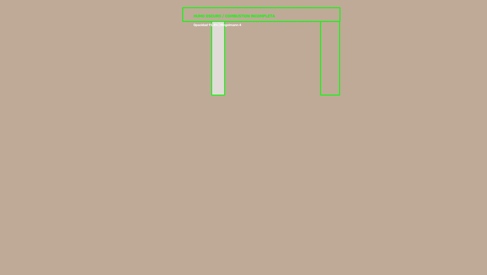

# rtsp-smoke-detection

**Detección de humo en cámaras IP sin GPU, sin dataset y sin reentrenar.**
Mide opacidad por contraste relativo contra zonas limpias de la misma escena y la clasifica en la escala Ringelmann.

**Smoke plume detection for IP cameras — no GPU, no dataset, no retraining.**
Relative-contrast opacity measurement against clean reference zones, classified on the Ringelmann scale.




<sub>Imagen sintética de demostración: zona de pluma y zonas de referencia anotadas · Synthetic demo image: plume and reference zones annotated</sub>

---

## El problema

Detectar humo en una cámara de vigilancia suena a problema de deep learning, y normalmente se resuelve así: consigues miles de imágenes etiquetadas, entrenas un modelo, lo despliegas con GPU, y seis meses después cambiaste la cámara de lugar y el modelo dejó de funcionar.

Este proyecto ataca el problema por otro lado. El humo de una chimenea tiene una firma física muy simple:

1. **Sube la luminancia** — las partículas dispersan luz y la zona se ve más clara.
2. **Baja la saturación** — el humo blanquea los colores.
3. **Ocupa una zona conocida** — la pluma siempre sale del mismo punto.

Si mides esos tres efectos **contra zonas de la misma imagen que nunca deben tener humo**, obtienes una medida de opacidad relativa que es inmune a la hora del día, al clima y al tráfico de camiones.

## Cómo funciona

```
                    ┌─────────────────────┐
                    │  Viga superior (B)  │  ← referencia limpia
                    └─────────────────────┘
        ┌──────┐              ┌──────┐
        │Pluma │              │ Ref A│         ← referencia limpia
        │ (P)  │              │      │
        └──────┘              └──────┘
```

Para cada fotograma:

```
luma_gain   = (luma_P - luma_A) / luma_A × 100
sat_loss_A  = (sat_A  - sat_P)  / sat_A  × 100
sat_loss_B  = (sat_B  - sat_P)  / sat_B  × 100

señal  = 0.5·luma_gain + 0.4·sat_loss_A + 0.5·sat_loss_B
opacidad = slope · señal + offset
```

Los coeficientes `slope` y `offset` salen de **dos muestras conocidas** (una sin humo y una con humo de opacidad medida). Dos incógnitas, dos ecuaciones — el comando `--calibrate` las calcula.

Como la referencia está en la misma imagen, la medida se cancela ante cambios globales de luz. Si oscurece, la referencia oscurece igual y el cociente no cambia.

## Clasificación

| Opacidad | Estado (`code`) |
|---|---|
| < 5% | Despejado / sin humo (`CLEAR`) |
| 5–40% | Humo claro / blanco (`LIGHT`) |
| 40–70% | Humo gris (`GRAY`) |
| > 70% | Humo oscuro / combustión incompleta (`DARK`) |

El número Ringelmann se reporta aparte con la escala estándar: **cada grado equivale a 20% de opacidad** (1 = 20%, 2 = 40%, 3 = 60%, 4 = 80%, 5 = 100%), redondeado al grado más cercano.

Los umbrales son configurables. La escala Ringelmann es la referencia estándar para evaluar opacidad de plumas en inspecciones ambientales.

## Instalación

```bash
git clone https://github.com/javieratcservicios/rtsp-smoke-detection.git
cd rtsp-smoke-detection
pip install -r requirements.txt
cp config.example.json config.json
```

## Configuración

### 1. Credenciales (nunca en el JSON)

```bash
export CAMERA_USER="admin"
export CAMERA_PASS="tu_contraseña"
```

### 2. Cámara

```json
"camera": {
  "rtsp_url": "rtsp://192.168.1.50:554/Streaming/Channels/101",
  "isapi_snapshot_url": "http://192.168.1.50/ISAPI/Streaming/channels/101/picture"
}
```

- **`isapi_snapshot_url`** es la vía preferida — un JPEG por HTTP, rápido y a resolución nativa. Es el protocolo de Hikvision y compatibles.
- **`rtsp_url`** es el fallback universal, vía OpenCV + FFmpeg. Más lento y con más compresión.
- Si tu cámara solo habla RTSP, deja `isapi_snapshot_url` vacío.

### 3. Zonas

Primero saca un fotograma para ver la escena:

```bash
python smoke_detect.py --config config.json --snapshot
```

Te dice la resolución real. Ajusta `reference_size` a esa resolución y define los tres rectángulos como `[x1, y1, x2, y2]`:

- **`plume`** — donde sale el humo. Cubre la boca de la chimenea y su trayectoria vertical.
- **`reference_a`** — una zona de la misma altura que nunca tiene humo (otro poste, el cielo despejado al lado).
- **`reference_b`** — una zona superior cercana (una viga, el borde del techo).

> **La regla que importa:** las referencias deben estar **a la misma distancia de la cámara** y **nunca** recibir la pluma. Si la referencia se contamina con humo, la medida se va a cero y el detector se vuelve ciego.

### 4. Calibración

Toma dos capturas reales y mide la opacidad de la que tiene humo (con un opacímetro, o estimándola visualmente contra la escala Ringelmann):

```bash
python smoke_detect.py --calibrate sin_humo.jpg con_humo.jpg --known-opacity 30
```

Copia la salida en `config.json`:

```json
"calibration": { "slope": 1.257143, "offset": -15.671429 }
```

**Si no calibras**, los valores por defecto son un punto de partida razonable, pero la escala absoluta no será exacta. Para uso cualitativo (hay humo / no hay humo) funciona; para reportar un porcentaje, calibra.

## Uso

```bash
# Guardar un fotograma para elegir zonas
python smoke_detect.py --config config.json --snapshot

# Medición en vivo (ráfaga de 5 fotogramas)
python smoke_detect.py --config config.json --measure

# Salida en JSON, para integrar con otro sistema
python smoke_detect.py --config config.json --measure --json

# Analizar una imagen que ya tienes
python smoke_detect.py --config config.json --image foto.jpg

# Derivar la calibración
python smoke_detect.py --calibrate clear.jpg smoke.jpg --known-opacity 30
```

### Uso desde Python

```python
from smoke_detect import load_config, grab_burst, analyze

cfg = load_config("config.json")
frames = grab_burst(cfg)
result = analyze(frames, cfg)

if result:
    print(result["label"], result["opacity"], result["ringelmann"])
    if result["code"] in ("GRAY", "DARK"):
        print("¡Alerta de emisión!")
    elif result["code"] == "NIGHT":
        print("Sin medición: escena demasiado oscura")
```

## Salidas

Cada medición guarda en `captures/`:

- `smoke_<timestamp>_annotated.jpg` — imagen con las tres zonas dibujadas y los valores
- `smoke_<timestamp>_plume.jpg` — recorte de la zona de pluma

## Notas de operación

- **Modo nocturno automático.** Bajo cierta luminancia media, el análisis de contraste no es fiable y el script devuelve `code: "NIGHT"` con `opacity: null` — **no** "despejado". Quien consuma la salida debe tratar `NIGHT` como "sin medición", nunca como "sin humo". Configurable en `night.enabled` / `night.mean_luma_below`. No lo desactives si la cámara opera 24 h: darás falsas alarmas toda la noche.
- **El movimiento no es señal de humo.** `motion` se reporta pero no entra en la clasificación. Un camión pasando genera movimiento y cero opacidad.
- **Ráfaga, no fotograma único.** El análisis usa varios fotogramas porque un solo JPEG puede caer en un instante de compresión fea. Con 5 fotogramas se promedia el ruido.
- **Reajusta las zonas si mueves la cámara.** No hay forma de evitarlo: las coordenadas son de la escena, no del equipo. Si cambias resolución, solo actualiza `reference_size` — las cajas se reescalan solas.
- **No es un detector certificado.** Sirve para monitoreo continuo y alertamiento temprano. Para cumplimiento normativo con método oficial (EPA Method 9 / opacímetro), esto es un complemento, no un sustituto.

## Licencia

MIT — ver [LICENSE](LICENSE).

---

## English

Measures smoke opacity on IP cameras by comparing the plume zone against clean reference zones **in the same frame** — a relative measurement, so it cancels out lighting and weather changes.

```bash
pip install -r requirements.txt
export CAMERA_USER=admin CAMERA_PASS=secret
python smoke_detect.py --config config.json --snapshot   # pick your zones
python smoke_detect.py --calibrate clear.jpg smoke.jpg   # derive slope/offset
python smoke_detect.py --config config.json --measure
```

- Works with Hikvision ISAPI over HTTP (preferred) or plain RTSP via OpenCV
- No GPU, no labelled dataset, no retraining when the scene moves — just re-draw two rectangles
- Classifies on the Ringelmann opacity scale
- Automatic night mode: skips contrast analysis when the scene is too dark to be reliable

Not a certified opacity monitor — it's early-warning telemetry for continuous monitoring.
